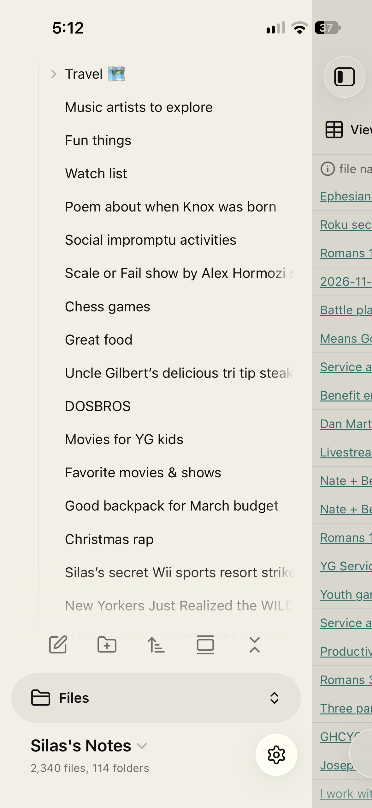
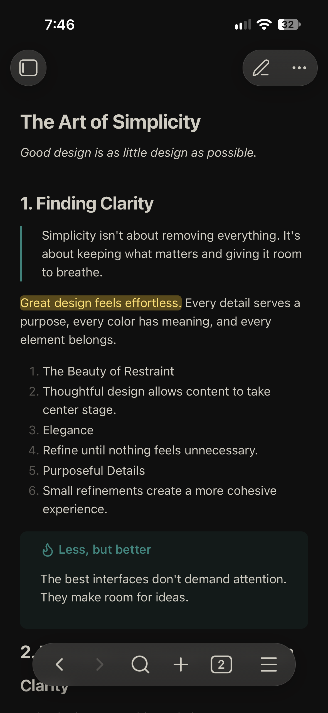
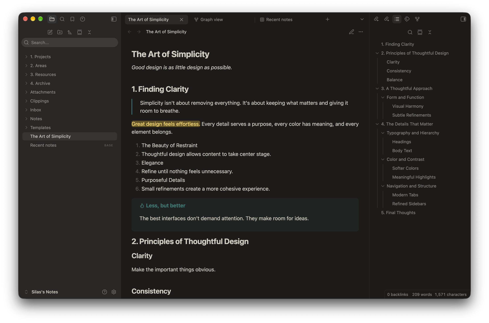
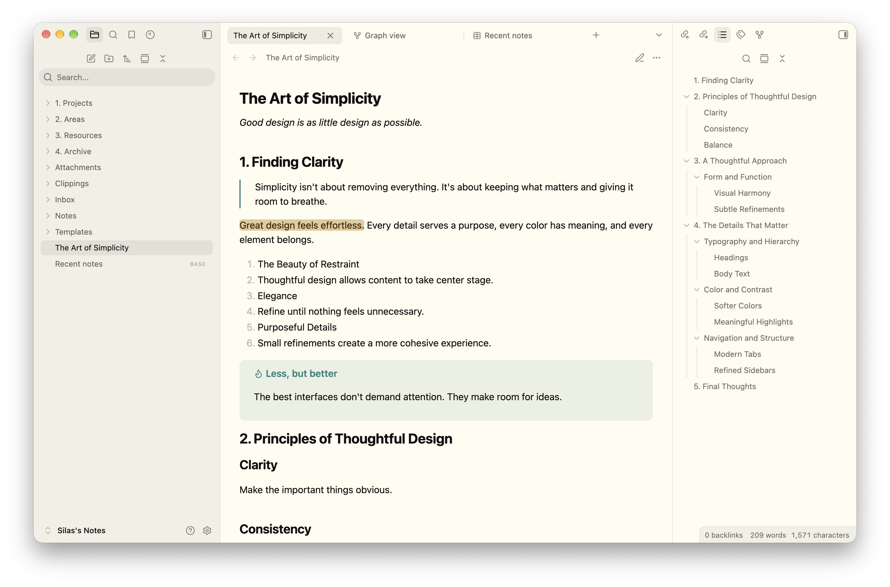

# Flexoki-Refined

A refined version of the [Flexoki theme for Obsidian](https://github.com/kepano/flexoki-obsidian), created by Silas Johnson.

I'm a big fan of Flexoki, but I made some tweaks to the interface on both desktop and mobile to make Obsidian look more modern.

## Tweaks I made:

- Softer colors on mobile- dark grey and light tan 
- Added subtle fades to soften hard edges on desktop
- Added a fade in the sidebars where text would ordinarily be cut off with an ellipsis
- Modernized desktop tabs aesthetic
- Refined sidebar aesthetics be removing extra borders for a more minimal look
- Refined the look of text highlights to be sleeker and more consistent

Yet this theme is true to the beautiful original Flexoki color palette and general aesthetic.

## Credits

Based on [Flexoki for Obsidian](https://github.com/kepano/flexoki-obsidian) by [Kepano](https://github.com/kepano).

Licensed under the MIT License. See [LICENSE](LICENSE) for details.
